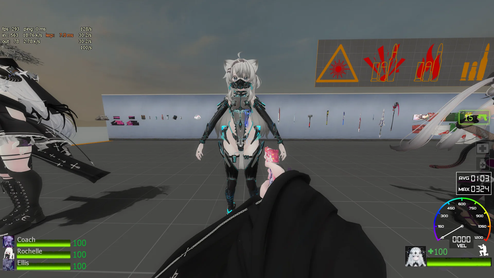
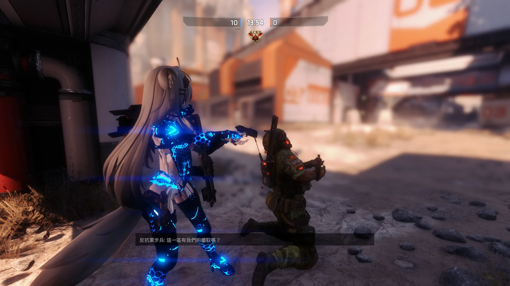
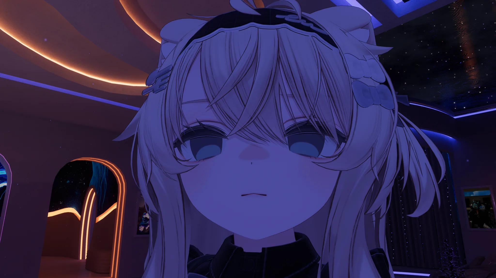

{: width="1920" height="1080" loading="lazy" decoding="async"}

L4D2这个我感觉还可以，挺好看的，模型也基本看不出问题~

{: width="1920" height="1080" loading="lazy" decoding="async"}

TTF2这个手模差点意思，其他我感觉都很可以了！

（附几张近照）

{: width="2048" height="1152" loading="lazy" decoding="async"}
{: width="2048" height="1152" loading="lazy" decoding="async"}
{: width="2048" height="1152" loading="lazy" decoding="async"}
{: width="2048" height="1152" loading="lazy" decoding="async"}
{: width="2048" height="1152" loading="lazy" decoding="async"}
{: width="2048" height="1152" loading="lazy" decoding="async"}
{: width="2048" height="1152" loading="lazy" decoding="async"}
