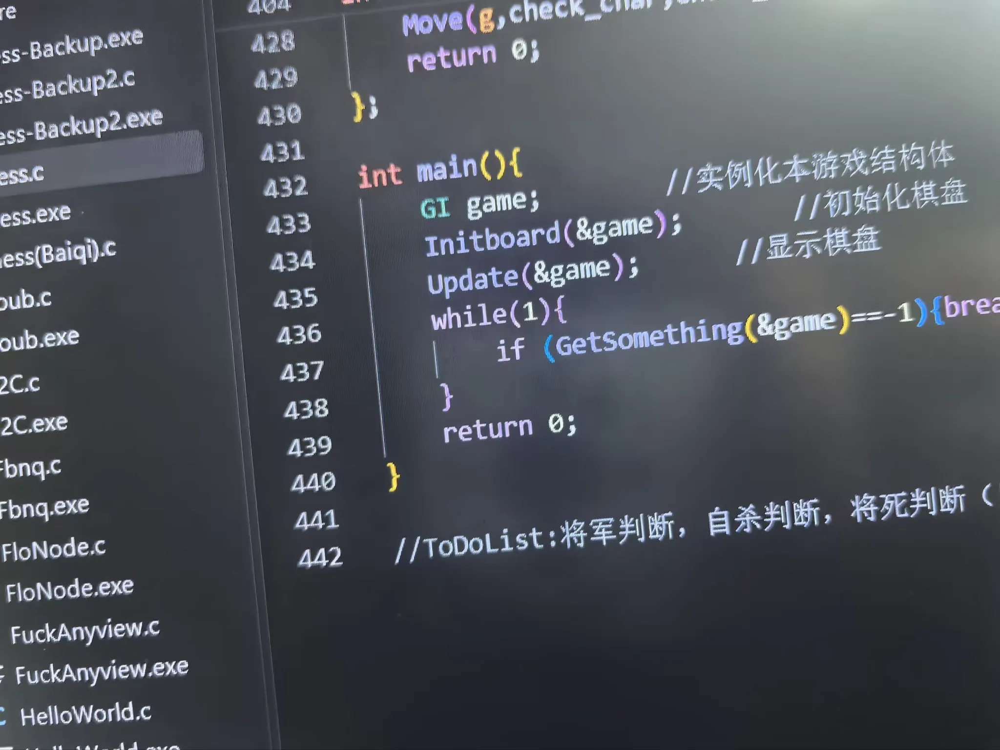
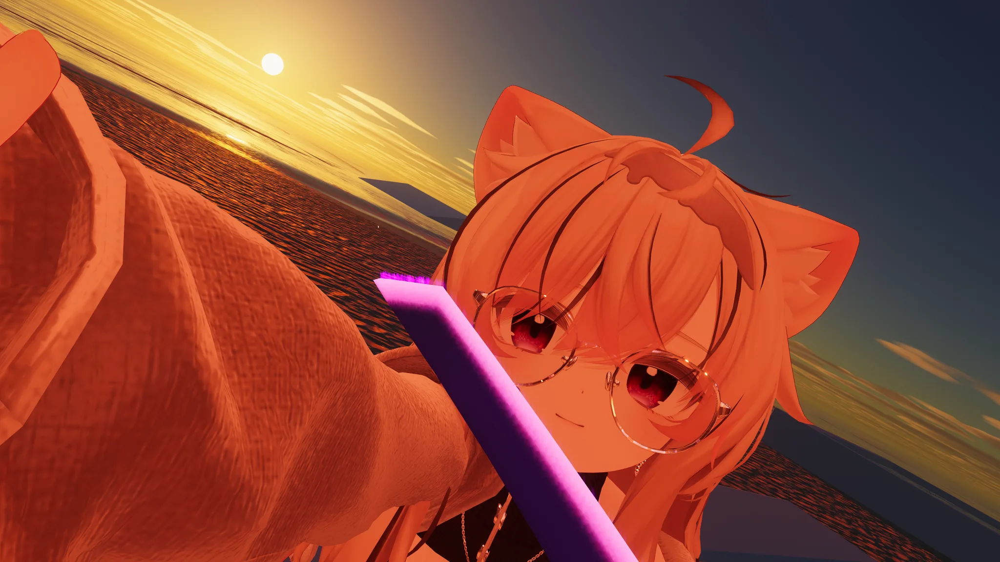

你们不准笑，这都是我一行一行亲手拉的😭

{: width="2048" height="1536" loading="lazy" decoding="async"}
（由我编写，交由DeepSeek-4.1-flash测试及反馈，由ChatGPT 5.6Sol提供国际象棋背景知识）

周二的英语阅读也还没写，中午得补了。

实验报告赶在截止前6秒钟交上去了🤣

{: width="2048" height="1152" loading="lazy" decoding="async"}
